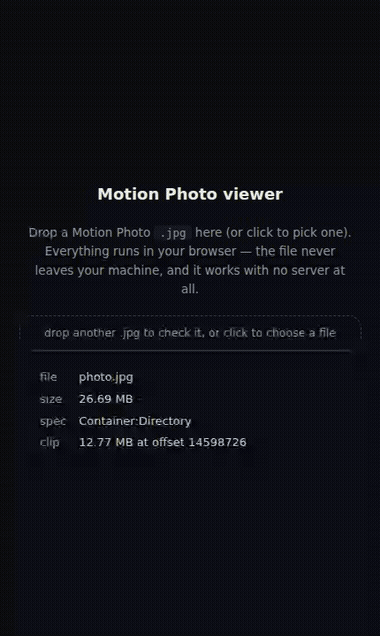

# motion-photo-bridge

**vivo / iQOO 手机拍的动态照片，在 Immich 里会变成「一张照片 + 一个小视频」两个文件。这个工具把它们补成标准的单文件动态照片 —— 包括已经进库的照片。**

**Live photos from vivo / iQOO phones don't work in Immich. This fixes that — including the photos already in your library.**



*One `.jpg`. Click it and the 2.9-second clip inside plays — recorded from a real vivo X100 Ultra live photo.*

---

## 30 秒最快路径（只做离线转换）

```bash
pip install motion-photo-bridge
mpb doctor                                  # 只查 Python + ffmpeg + 内置引擎，不碰 Immich
mpb scan   ~/Pictures/vivo                  # 看看能配出多少对
mpb convert ~/Pictures/vivo -o ~/Pictures/fixed --transcode
```

三条命令就够。不用装 Immich、不用 Python 环境以外的任何东西（ffmpeg 除外）。
**照片来自网盘同步盘、或从手机相册手工拷贝出来，也可以直接跑** —— 见下面「不同来源都能用」。

---

## 中文说明（先看这个）

### 问题出在哪

vivo / iQOO 的动态照片落盘是**两个独立文件**：同名的 `IMG_xxx.jpg` + `IMG_xxx.mp4`。两者之间
没有标准元数据，只有各自身尾部一段 vivo 私有 JSON 里的同一个 ID
（`com.android.camera.livephoto`）—— Immich 只认 Apple 的 `ContentIdentifier` 和 Google 的
`Camera:MotionPhoto`，所以这段私有 ID 它根本不看。结果就是时间线里多出一个孤立小视频，下载给两个
文件；Windows 上那小段视频还常常**黑屏只剩声音**（vivo 录的是全范围 `yuvj420p`，硬件解码器拒播）。

### 它做什么

```
JPG + MP4 ──► 可选转码 ──► 合并 ──► 一个标准 Motion Photo JPEG
                                    （像素与 EXIF 逐字节原样）
```

1. **配对** —— 优先用 vivo 私有 ID（相册另存/改名也不怕），没有 ID 时退回「同名 + 同目录 + 片段 ≤ 10 秒」。
2. **转码**（可选）—— 全范围片段重编码成 limited-range H.264/BT.709，修掉 Windows 黑屏。
3. **合并** —— 把片段追加到 JPEG 尾部并写入 `Container:Directory` XMP，成为标准动态照片。
4. **关联** —— Immich 里给图片写 `livePhotoVideoId`、隐藏那个小视频，和 Immich 自己处理 iPhone 动态照片的做法一致。

### 不同来源都能用

| 来源 | 会遇到什么 | 工具怎么处理 |
| --- | --- | --- |
| 手机 DCIM 原样拷出 | 正常双文件 | 直接配对合并 |
| 网盘同步目录（OneDrive/坚果云/NAS） | `Thumbs.db`、`._xxx.jpg`、`@eaDir/`、`.crdownload` 半成品、`IMG_1 (1).jpg` 副本 | 自动跳过垃圾与半成品；副本与原图同组时**优先原始文件名**；可递归子目录并保持目录结构 |
| 从相册「另存/导出」再拷出来 | 文件名被改（`DSC_0001 copy.jpg`）、剪辑丢了拍摄时间（报「缺少可比较的拍摄时间」） | 先按 vivo 私有 ID 认人（改名也能配上）；ID 没了就读 JPEG 的 EXIF，把拍摄时间补到剪辑上再合并 |
| 只想要 .MOV（Apple 形态） | 默认不处理 | `--include-mov` |

### 三种用法

| 场景 | 命令 |
| --- | --- |
| 照片还在电脑上，入库前处理 | `mpb convert ~/Pictures/phone -o ~/Pictures/fixed --transcode` |
| 已经进了 Immich，不想重传 | `mpb apply-pair --image-id <uuid>`（单张）/ `mpb apply-batch --owner <邮箱>`（全库，可续跑） |
| 想全自动 | 上传即关联（Immich workflow + `mpb serve`），定时再自动合并（`mpb auto-merge`，每 6 小时） |

**已入库的照片不用重传**：原地替换图片文件，资产 ID、相册、标签、收藏、拍摄时间全部保留；每对
先备份到独立目录，可中断、可续跑，回滚就是把备份拷回去。

### 哪些 vivo 机型真的需要它

同是 vivo，出片格式按机型分两代：

| 机型 | 落盘形态 | 需要本工具吗 |
| --- | --- | --- |
| **X300 / X300 Pro**（2025-10 起）、X300 Ultra、X300s、X500 系列 | 标准单文件 Motion Photo（JPEG + 追加 MP4 + 标准 XMP），Immich 原生识别 | 不需要 |
| **X100 / X200 系列**（含 X100 Ultra、X200 Pro Mini）及更早 | 同名 `JPG` + `MP4` 两个文件，靠私有 ID 配对 | **需要** |

新机型只是把私有 JSON 保留成「双尾」（MP4 `ftyp` 前一份、文件末尾一份），正文已经是标准结构。

固件升级不会回填：X200 系列在 OriginOS 6 上仍复现双文件。所以老机型想要「拍照即单文件」，只能靠
入库后自动合并 —— 效果等同于新机型出片，区别是手机上那两份原件还在。

### 一个必须知道的副作用

合并会改写文件字节，但工具**故意保留原始的 checksum**——因为 Immich 手机端是靠「本地文件 SHA1 == 服务器
checksum」判断"是否已备份"的（`backup.repository.dart`），改了它，手机就会认为这些照片从没上传过，
每次同步都把原图重传一遍。

代价是：Immich 后台的 **完整性检查 → checksum files** 会把这些资产列成 `ChecksumFail`。那只是一份
报告，不会删文件、不会改资产、不影响播放和下载。可以忽略，或者只关掉这一项检查。

### 验证过什么

- ~1000 对真实 vivo X100 Ultra 动态照片（跨两个账号）走完整流程。
- 合并后的 JPEG：像素解码哈希与原件**完全一致**，内嵌片段可被 `ffprobe` 正常读出（H.264 + AAC）。
- 配对：把其中一半 `mp4` 改名成 `gallery-renamed-13.mp4` 后，仍按私有 ID 全部正确配上。
- Immich 端：图片 `livePhotoVideoId` 已写、视频 `hidden`、视频挪进 `encoded-video/`，下载只给一个文件。

---

## The problem

Immich recognises two kinds of live photo:

| Kind | How it is detected |
| --- | --- |
| Apple Live Photo | `HEIC` + `MOV` paired by `ContentIdentifier` metadata |
| Android Motion Photo | a single JPEG with the video embedded (`Camera:MotionPhoto` XMP or `MicroVideo`) |
| **vivo / iQOO live photo** | **neither** — two plain files joined only by a private `vivo Live Photo ID` that Immich never reads |

So a vivo live photo lands as **two assets**: the picture, plus a 2-second clip sitting next to it
in the timeline. Downloading gives you two files instead of one moving picture. And on Windows the
clip often plays as a **black frame with audio**, because vivo records it full-range (`yuvj420p`)
and the hardware decoder refuses it.

The same shape (a `JPG` and a same-stem `MP4`) shows up on some OPPO / realme builds.

## What this does


```
JPG + MP4 ──► optional transcode ──► merge ──► one Motion Photo JPEG
                                               (pixels + EXIF copied byte-for-byte)
```

1. **Pair** — by vivo's private `livephoto` id when both files carry one, otherwise by
   same folder + same filename stem with a clip ≤ 10 s. The id survives a gallery re-save; the
   filename does not.
2. **Transcode** (optional) — re-encode full-range clips to limited-range 4:2:0 BT.709 so Windows
   browsers and the Photos app play them instead of showing black. Clean clips are skipped.
3. **Merge** — append the clip to the JPEG and write the `Container:Directory` XMP block.
4. **Link** — in Immich the image gets `livePhotoVideoId` and the clip is hidden, which is exactly
   what Immich does for a phone it recognises.

## Install

```bash
pip install motion-photo-bridge
# 或者从源码：
# git clone https://github.com/duruonanni/motion-photo-bridge && cd motion-photo-bridge && pip install .
```

The merger is vendored under `motion_photo_bridge/_vendor` (MIT, see
`NOTICE.md`) — there is no second package to install, and the package itself has
**zero runtime dependencies**:

```bash
pip install motion-photo-bridge          # PyPI, 0.2.2+
```

`ffmpeg` and `ffprobe` must be on `PATH` — `mpb doctor` checks that (and only
checks Immich when you pass `--immich`).

## Inspect a file, offline

Open [`docs/viewer.html`](docs/viewer.html) in a browser and drop a JPEG on it. It tells you whether
the file is a Motion Photo, which spec it uses and how big the embedded clip is — and lets you play
it. No server, no upload, works straight from `file://`.

## Convert files before uploading

```bash
mpb scan    ~/Pictures/phone                       # what would be paired
mpb convert ~/Pictures/phone -o ~/Pictures/fixed --transcode
```

`convert` writes `<stem>.jpg` containing the clip. **The originals are never modified.**

## Fix a library you already have

This is the part most tools skip. If the split pairs are already imported you do **not** have to
delete and re-upload — asset IDs, albums, tags, favourites and dates all survive.

```bash
# one pair
mpb apply-pair --image-id <asset-uuid> --dry-run
mpb apply-pair --image-id <asset-uuid>

# the whole library, resumable
mpb apply-batch --owner you@example.com --dry-run
mpb apply-batch --owner you@example.com
```

Per pair it:

1. backs the original `jpg` + `mp4` up;
2. transcodes + merges;
3. replaces the image's file **in place** — the path and the asset ID never change;
4. moves the clip into Immich's `encoded-video/` folder, the folder Immich treats as "embedded
   video", so downloads skip it;
5. updates `checksum`, `originalPath`, `duration` and `fileSizeInByte` to match the new file.

It refuses to merge when both files carry a private id and the ids **disagree** — that pair was
matched on filenames alone, and merging it would attach the wrong clip.

It is **idempotent and resumable**: a pair whose clip already lives under `encoded-video/` is
skipped, so you can stop and restart freely. Every pair is backed up first, and rolling back means
copying the backup over the file again.

These commands drive Immich through `docker compose exec … psql`, so they expect a local Compose
deployment and **three environment variables** (no machine-specific defaults are baked in):

```bash
export IMMICH_COMPOSE_DIR=~/immich            # folder with docker-compose.yml / compose.yaml
export IMMICH_MEDIA_DIR=~/immich/library      # host path of the upload folder
export MPB_BACKUP_DIR=~/immich-backup/vivo    # where originals are copied before merging
mpb doctor --immich                            # verifies the three paths + the database
```

`apply-pair` is safe to re-run: it refuses to touch a file that is already a single Motion Photo.

Verify a pair afterwards:

```bash
python3 tools/verify_apply.py <image-uuid> <video-uuid>
```

It reports the asset state and the contents of the download archive — you want to see **one** file
there.

## Keep it automatic

Two layers, both optional and independent:

**1. Link on upload** (seconds). Immich has no third-party plugin loader yet, but since **v3.0** it
ships workflows with a webhook action, and that is the supported extension point:

```
phone uploads JPG + MP4
        │
        ▼
Immich ── Workflow (AssetCreate, filename matches \.mp4$) ──► POST
        │                                                     │
        ▼                                                     ▼
   asset in library                       motion-photo-bridge serve
                                                 (finds the same-stem image,
                                                  links it through the Immich
                                                  API; Immich then hides the clip)
```

```bash
mpb serve --port 9100
```

It needs an Immich API key for the account that owns the photos (`asset.read` +
`asset.update`) in `API_KEY`, and `IMMICH_URL` pointing at your instance. Then, from that same
account, paste [`docs/immich-workflow.json`](docs/immich-workflow.json) into
**Utilities → Workflows** and point its `url` somewhere Immich can reach — on a Docker bridge
network that is usually `http://172.17.0.1:9100/…`.

> Workflows are scoped to their owner: create it with the account that uploads the photos, not as
> an admin acting on someone else's behalf.

**2. Link + merge on a timer** (minutes, every 6 h). The webhook can only link: merging rewrites
the stored file, which is not something to do inside an upload event. `tools/auto_merge.py` does
both stages, is idempotent, and prints nothing when there is no work:

```bash
python3 tools/auto_merge.py --dry-run          # what is pending
python3 tools/auto_merge.py                    # link (id-first) + merge, all owners with vivo photos
python3 tools/auto_merge.py --owner you@example.com --limit 10
```

Run it from cron:

```cron
0 */6 * * *  cd ~/motion-photo-bridge && .venv/bin/python tools/auto_merge.py --quiet
```

Apple-style `JPG + MOV` pairs (`still-image-time`, `com.apple.quicktime.content.identifier`) are
linked but **not** merged — they are already a coherent live photo, and merging gains nothing.
Pass `--include-mov` if you want them turned into single files anyway.

Test the whole chain:

```bash
IMMICH_VIVO_PASSWORD=... python3 tools/test_e2e_immich.sh
```

It uploads a real pair, waits for the link and the hidden flag, then trashes the test assets. The
clip content is randomised on purpose: identical bytes get deduplicated by Immich, no `AssetCreate`
event fires, and the test passes for the wrong reason.

## Troubleshooting

**`Ambiguous — missing comparable capture time`.** The merger pairs a JPEG with its clip by
comparing capture times, and some JPEGs carry no date at all (hand-exported frames, some gallery
re-exports). Write one in first — this refuses to touch a file that already has EXIF:

```bash
python3 tools/stamp_capture_time.py photo.jpg "2026:01:01 12:00:00"
```

**Times come out 8 hours apart.** The merger compares the JPEG's local `DateTimeOriginal` against
the clip's `creation_time` normalised to local time. Re-encoding a clip drops its original stamp, so
pass the photo's capture time when transcoding — `tools/apply_pair.py` takes it from Immich's
`dateTimeOriginal`.

**A photo edited in the phone's gallery pairs with the wrong time.** vivo's gallery re-saves an
edited live photo and rewrites the file name, the mtime and the clip's `creation_time` to the
*export* moment, while keeping the original `DateTimeOriginal`. **Trust EXIF, not the file name:**
one such photo is named `IMG_20261005_000310` but its EXIF says `2026-10-04 14:09:23` — three
seconds after `IMG_20261004_140920`, while the minute its name claims contains no photos at all.
This is also why pairing prefers the private id over the filename.

**After merging, the phone re-uploads the original JPG + MP4.** Immich's mobile app decides
"already backed up" by comparing the local file's SHA1 against `asset.checksum` on the server
(`backup.repository.dart`: `remoteAssetEntity.checksum.equalsExp(localAsset.checksum)`). Merging
rewrites the file, so **this tool keeps the original checksum on purpose** — otherwise every sync
sees the originals as new and uploads them again.

Consequence, by design: Immich's **Integrity → checksum files** report will list those assets as
`ChecksumFail` (byte hash no longer matches the recorded one). It is only a report — nothing is
deleted, moved or blocked. Ignore it, or turn that one check off if the noise bothers you.


**Xiaomi's gallery recognises a merged file, but Xiaohongshu still posts it as a still.**
Verified on a Xiaomi 15 (HyperOS 16): the merged JPEG shows the live badge and plays, yet the
same file uploaded to Xiaohongshu stays static, while a photo taken by the phone uploads fine.
Byte-level comparison of the two files shows the phone's own capture carries three things ours
does not: an **MPF segment** (APP2 `MPF\0`), an **HDR gain map** (`GainMap` container item +
`hdrgm`), and device metadata inside the MP4 (`com.android.manufacturer=Xiaomi`,
`com.xiaomi.product.marketname`, HEVC instead of our re-encoded H.264). Xiaohongshu's decision is
therefore not "can this file play" but something vendor-specific — treat platform uploads as out
of scope and share from the phone's gallery instead.

**Windows plays a black frame (audio only).** The clip is full-range `yuvj420p` and Windows hardware
decoding chokes on it. `mpb convert --transcode` re-encodes it:

```bash
ffmpeg -i in.mp4 -vf "scale=in_range=full:out_range=limited,format=yuv420p" \
  -c:v libx264 -profile:v high -crf 20 -color_range tv \
  -colorspace bt709 -color_primaries bt709 -color_trc bt709 \
  -c:a aac -b:a 96k -movflags +faststart out.mp4
```

Before blaming the merge, check the same file in another player: Linux/Chromium software decoding
shows these clips fine, which is what made this look like an Immich bug at first.

**`mpb convert` prints FAIL and a reason.** The upstream merger exits `0` even when it declines to
pair a file, so the CLI verifies the artefact and reports the merger's own reason (`Ambiguous`,
`Rejected`, …) instead of trusting the exit code.

## Scope and limits

- Pairs are only touched when the clip is ≤ 10 s (or carries the same private id as the photo).
  Anything else is reported and skipped.
- Original files are never deleted — `convert` writes new files, and the library mode keeps a backup.
- JPEG pixels and the entire EXIF segment are copied unchanged (checked by hashing the decoded
  pixels before and after: identical).
- Verified against ~1000 pairs from a vivo X100 Ultra, across two Immich accounts.
- No Immich source changes. This talks to the official API and to workflows, so your instance stays
  a stock Immich — including across upgrades.

## Credits

- Merging is delegated to [`oneone1995/android-motion-photo-merger`](https://github.com/oneone1995/android-motion-photo-merger)
  (MIT) — it does the JPEG/XMP work correctly.
- Thanks to the Immich maintainers for shipping workflows with a webhook action instead of forcing
  people to fork.

## License

MIT
